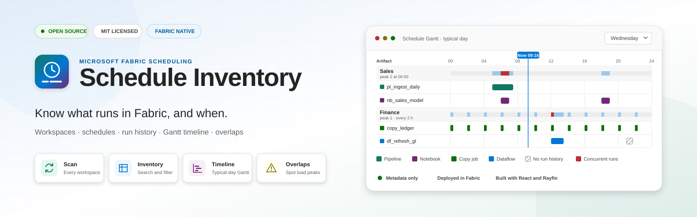
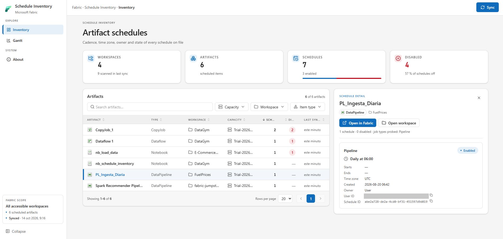
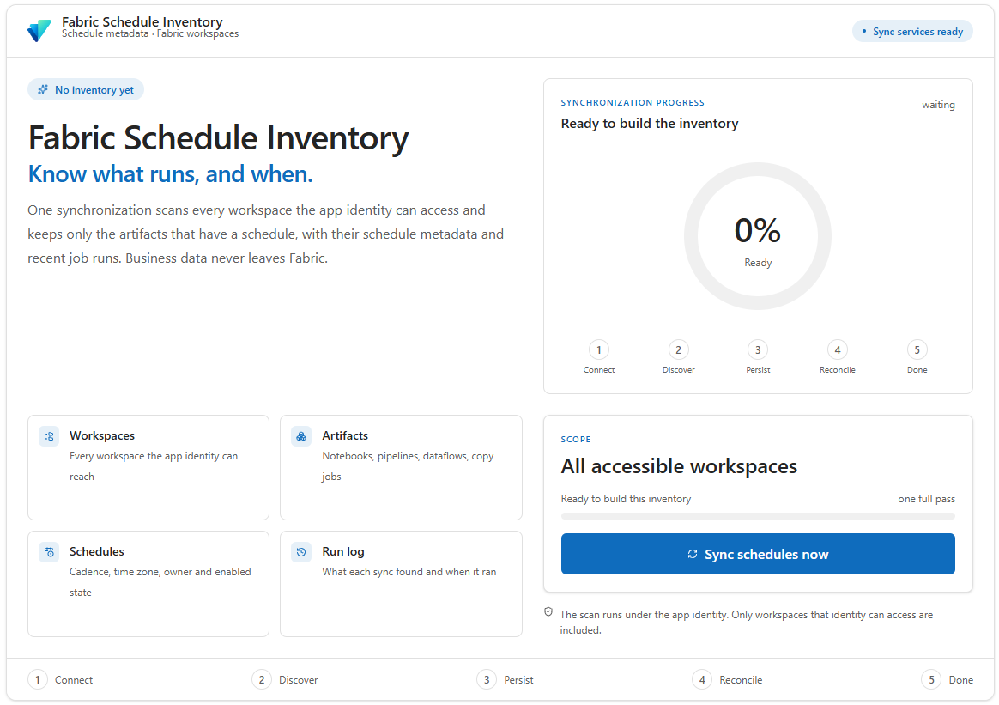
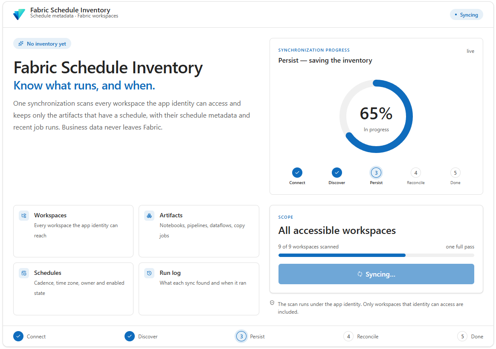
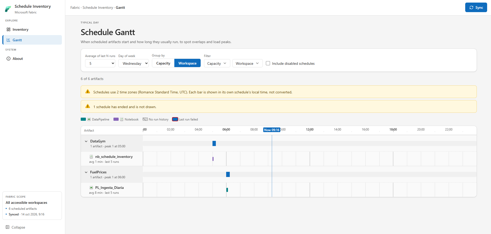
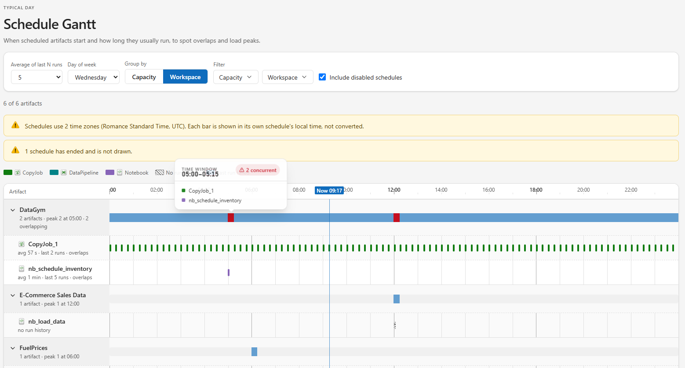
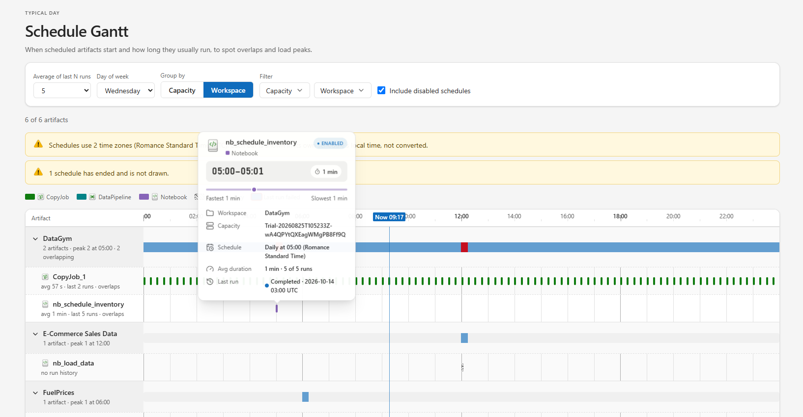
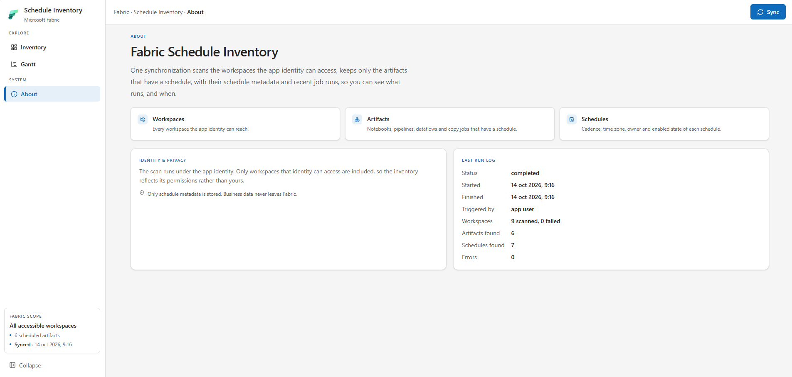

<div align="center">




</div>

# Fabric Schedule Inventory

A [Microsoft Fabric](https://learn.microsoft.com/fabric/) app that answers one question: **what is scheduled to run in my Fabric tenant, and when?**

It scans every workspace the app identity can access, keeps only the items that have at least one schedule (notebooks, pipelines, dataflows, copy jobs, semantic models, …), and shows them as a searchable inventory and a 24-hour Gantt timeline so you can spot overlaps and capacity peaks.

Built as a Fabric App with Project Rayfin (React + Vite frontend, Fabric user data functions, app-owned data).



## Features

- **Tenant-wide scan** of every workspace the app identity can see, with live sync progress.
- **Inventory** of scheduled items with search, capacity / workspace / item-type filters, sorting, paging and direct links to the Fabric portal.
- **Gantt timeline** of a "typical day", with bars sized by the average duration of recent runs, grouped by capacity or workspace, plus a per-group load strip and peak concurrency.
- **Run history**: the last 20 job runs of every scheduled item are stored at sync time.
- Keyboard accessible, works inside the Fabric portal or standalone, and follows the host's light or dark appearance (light by default).

## Pages

### First run and sync

<p>
  
  
</p>

Until the first sync there is no inventory, so the app opens on a start page that explains what will be scanned. Pressing **Sync schedules now** starts the scan and shows its progress through five stages: Connect, Discover, Persist, Reconcile and Done. Afterwards the **Sync** button in the header runs it again from any page.

### Inventory (`#/`)


Every scheduled item with its schedules.

- Search, and filter by **capacity**, **workspace** and **item type**. Workspaces narrow to the selected capacity; active filters show as removable chips.
- Sort by any column and page with 10, 20 or 50 rows per page.
- Selecting a row opens its schedules beside the table (below it under 1536 px). On narrow screens rows become cards.
- Summary tiles show workspaces, artifacts, schedules and disabled schedules.

### Gantt (`#/gantt`)



A 24-hour timeline with one row per scheduled item.

- Bars start at the scheduled times and are as wide as the average duration of the last *N* runs (1, 3, 5, 10 or 20; default 5).
- Pick the weekday and group rows by **capacity** or **workspace**. Each group shows a load strip (15-minute windows) and its peak concurrency.
- Multi-select **Capacity** and **Workspace** filters apply before grouping, so load and peaks reflect only the filtered set.
- Hover, focus or tap a bar for details: item, workspace, capacity, schedule, time range, average / min / max duration, last run status and whether the schedule is enabled. Bars are keyboard navigable (arrow keys, Home, End; Escape closes the tooltip).
- Bars are coloured by item type, outlined red when the last run failed, and a marker shows the current time when the selected weekday is today.
- Disabled schedules are hidden unless **Include disabled schedules** is checked.

<p>
  
  
</p>

The load strip highlights windows where several artifacts overlap and lists them on hover (left); a bar's tooltip shows its schedule, duration range and last run (right).

Limits worth knowing:

- Items without run history get a hatched placeholder bar.
- Cron schedules are capped at 288 bars per day; monthly schedules and schedules past their end date are counted in a notice but not drawn.
- Times are shown in each schedule's own time zone. Mixed zones are flagged, not converted.
- Capacity names come from `GET /capacities`, which Fabric only answers for capacities where the app identity is Admin or Contributor. Otherwise the app shows `Capacity <first 8 id chars>` and the sync records how many capacities could not be resolved.

### About (`#/about`)



What the app stores and the status of the latest sync.

## How it works

```text
Frontend (React)  ──invoke──▶  syncInventory (Fabric user data function)
      │                              │  Fabric REST API, app identity token
      │                              ▼
      │                        list workspaces → items → schedules → job runs
      │                              │
      └──── poll SyncRun ◀───────────┤  persist via Rayfin data client
            read Artifact / Schedule / JobRun
```

1. Pressing **Sync** invokes the `syncInventory` function.
2. The function creates a `SyncRun` record and scans workspaces with the app identity token, keeping only item types that can carry schedules (`SCHEDULABLE_ITEM_TYPES` in [`fabric-scan.ts`](packages/functions/src/fabric-scan.ts)).
3. Items with at least one schedule are stored as `Artifact` records with their `Schedule` and last 20 `JobRun` records. Items that lost all their schedules are removed.
4. While the sync runs, the frontend polls the latest `SyncRun` every 1.5 s to show progress, then refreshes the inventory.

Supported item types: Notebook, Data pipeline, Dataflow, Copy job, Lakehouse (table maintenance), Semantic model, Spark job definition, Environment, Mirrored database, Eventhouse, SQL database, Variable library and Warehouse snapshot.

## Quickstart

### Prerequisites

- Node.js 20, 22 or 24, and npm.
- A Microsoft account with access to a Fabric workspace where the app can be deployed.
- Azure Functions Core Tools to run `syncInventory` locally (installed in step 3).

### Steps

1. **Clone and install** (from the repository root only):

   ```sh
   git clone https://github.com/kilianbs/fabric-schedule-inventory.git
   cd fabric-schedule-inventory
   npm install
   ```

2. **Sign in** with the Rayfin CLI. Local development uses this session:

   ```sh
   npx rayfin login
   ```

3. **Install Azure Functions Core Tools** once (it asks for consent):

   ```sh
   npx rayfin dev functions apply
   ```

4. **Run locally**:

   ```sh
   npm run dev
   ```

   Open <http://localhost:5173>. The inventory is empty until the first sync: press **Sync** and wait for the scan to finish. The first sync also reads the run history of every scheduled item, so it takes longer than later ones.

5. **Deploy to Fabric** (this writes to a remote workspace, so confirm the target first):

   ```sh
   npm run rayfin:up
   ```

   Open the URL it returns, sign in and press **Sync** once.

> The scan only sees what the app identity can see. Give it access to the workspaces (and, for capacity names, Admin or Contributor on the capacities) you want to inventory.

## Development

### Commands

Run everything from the repository root.

| Command                  | What it does                                                        |
| ------------------------ | ------------------------------------------------------------------- |
| `npm run dev`            | Rayfin local services (data, functions, auth) plus the Vite server. |
| `npm run dev:frontend`   | Vite only. Enough to work on UI, but cannot run a sync.             |
| `npm run typecheck`      | Builds shared and functions, then type-checks all projects.         |
| `npm run build`          | Builds shared, functions, data and frontend in order.               |
| `npm run lint`           | ESLint on the frontend.                                             |
| `npm test`               | Vitest on the frontend.                                             |
| `npm run rayfin:up`      | Provisions or updates the app's Fabric resources.                   |

Run a single test file or test name:

```sh
npm run -w @rayfin-app/frontend test -- src/lib/gantt.spec.ts
npm run -w @rayfin-app/frontend test -- -t "averages only the last N runs"
```

Validation order before opening a PR: `typecheck` → `build` → `lint` → `test`. Run them one after another; `typecheck` and `build` share TypeScript outputs and must not run at the same time. The frontend build skips type checking, so a green `build` does not prove type safety.

### Project layout

```text
.
├── rayfin/rayfin.yml          # Rayfin services: auth, data, functions, static hosting
├── packages/
│   ├── shared/                # Browser-safe contracts (record types, app schema)
│   ├── data/                  # Entities: Artifact, Schedule, JobRun, SyncRun
│   ├── functions/             # syncInventory and Fabric REST helpers
│   └── frontend/              # React + Vite + Tailwind v4 UI
└── scripts/                   # Capability-pack tooling
```

- `packages/shared` must build before the other packages consume it.
- When adding an entity in `packages/data`, keep `UniversalAppSchema` in `packages/shared` in step with it.
- The frontend imports types from `@rayfin-app/shared`, never the decorated data classes.
- Routing is hash based (`#/`, `#/gantt`, `#/about`) because static hosting has no server fallback.
- All service calls go through `getRayfinClient()` in [`rayfin-client.ts`](packages/frontend/src/lib/rayfin-client.ts). No app content renders before authentication.

`AGENTS.md` and `CLAUDE.md` contain more detailed conventions for contributors and coding agents.

## Contributing

Issues and pull requests are welcome. Please run the validation commands above before submitting, and keep tests alongside behaviour changes.

## Credits

- Scaffolded from the Project Rayfin universal app template.
- Item type icons from [`@fabric-msft/svg-icons`](https://www.npmjs.com/package/@fabric-msft/svg-icons) (MIT), as catalogued by [FabricTools/fabric-icons](https://github.com/FabricTools/fabric-icons).

## License

[MIT](LICENSE)
